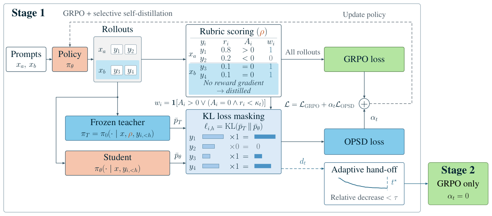
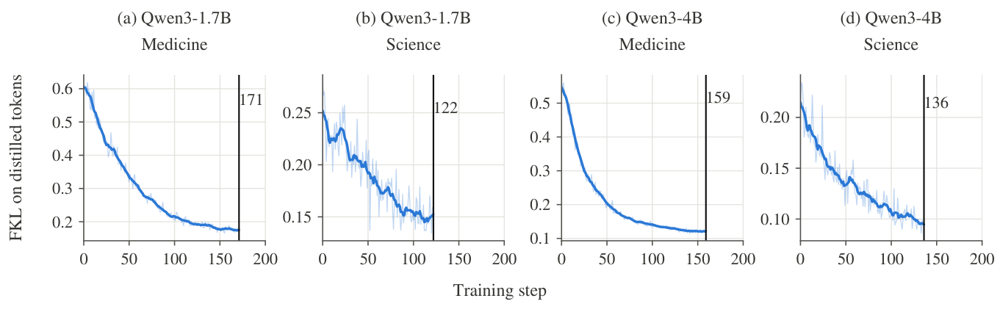

<div align="center">

<h1>
RELAY: Selective Self-Distillation with Adaptive Hand-off<br>
for Rubric-Based Reinforcement Learning
</h1>

<p>
  <a href="#"></a>
  <a href="LICENSE"></a>
</p>

</div>

---

## Paper

This is the official implementation of
**RELAY: Selective Self-Distillation with Adaptive Hand-off for Rubric-Based
Reinforcement Learning**. The paper is under anonymous review; the citation
will be added upon publication.

---

## Overview

<p align="center">
  
</p>

Rubric-based RL collapses many written criteria into one reward, discarding
the rubric's detail and giving no GRPO gradient when a group's responses tie.
A frozen teacher that reads the rubric as privileged context provides
token-level supervision, but the gains over GRPO plateau early. RELAY makes
both choices from the training signal itself:

- **Stage 1** — selective distillation from a frozen privileged-context
  teacher combined with GRPO. Advantages and rewards select
  positive-advantage and low-scoring zero-advantage rollouts (about half of
  the response tokens).
- **Plateau detection** — the relative decrease of the distillation loss
  retires the teacher once it flattens. Calibrated once on
  Qwen3-1.7B/Medicine and reused unchanged in the three other settings, it
  fires between steps 122 and 171.
- **Stage 2** — GRPO alone.

The repository supports Qwen3-1.7B and Qwen3-4B on user-supplied medicine or
science data, with a separate final GPT-5.1 evaluation entry point. Datasets,
weights, checkpoints, and experiment logs are not bundled.

---

## Results

Main results under GPT-5.1, averaged over three evaluations. Medicine and
science columns use separately trained models; Aggregate is the unweighted
mean of the five benchmarks. Best per model size in **bold**.

| Model | Method | RaR-Med. | HealthBench | LLMEval-Med | RaR-Sci. | ResearchQA | Aggregate |
|:---|:---|---:|---:|---:|---:|---:|---:|
| Qwen3-1.7B | Base | 34.87 | 21.91 | 54.11 | 47.79 | 43.54 | 40.44 |
| Qwen3-1.7B | + OPSD | 40.20 | 18.79 | 55.71 | 49.25 | 45.31 | 41.85 |
| Qwen3-1.7B | + GRPO | 42.15 | 23.87 | 56.28 | 52.79 | 51.11 | 45.24 |
| Qwen3-1.7B | + CriPO | 42.37 | 27.97 | 54.99 | 55.79 | **60.58** | 48.34 |
| Qwen3-1.7B | **+ RELAY** | **46.77** | **29.31** | **57.51** | **57.00** | 59.73 | **50.06** |
| Qwen3-4B | Base | 48.56 | 33.82 | 63.18 | 62.60 | 51.85 | 52.00 |
| Qwen3-4B | + OPSD | 56.13 | 29.17 | 66.21 | 63.29 | 52.89 | 53.54 |
| Qwen3-4B | + GRPO | 58.41 | 39.53 | 68.01 | 68.36 | 63.19 | 59.50 |
| Qwen3-4B | + CriPO | 59.67 | 41.93 | 67.77 | 66.17 | 63.95 | 59.90 |
| Qwen3-4B | **+ RELAY** | **64.43** | **42.63** | **69.14** | **69.80** | **65.79** | **62.36** |

<p align="center">
  
</p>

Per-token divergence during Stage 1 across the four settings; vertical lines
mark the plateau-rule trigger. The rule tests relative change and transfers
without re-tuning.

---

## Installation

Linux, Python 3.10, CUDA 12, and one node with **8 GPUs** (TP=4, DP=2, BF16).

```bash
python -m venv .venv && source .venv/bin/activate
python -m pip install --upgrade pip setuptools wheel packaging ninja
python -m pip install torch==2.8.0 torchvision==0.23.0 torchaudio==2.8.0
python -m pip install -r requirements.txt
python -m pip install --no-build-isolation -r requirements-kernels.txt
python -m pip install --no-deps -e ./mcore_adapter -e .
```

---

## Data

Prepare your own parquet files with the columns `id`, `messages`,
`prompt_str`, `tag` (`rubric_opsd_train` for training, `rubric_eval` or
`rar_science_eval` for validation), `rubrics_str`, `rubric_weights`,
`rubric_count`, and `ground_truth`. Rubric headers must match their weights,
e.g. `1. [POSITIVE REQUIREMENT, weight=+5] ...`. Datasets are not downloaded
or redistributed; use the official splits.

---

## Judge endpoint

An OpenAI-compatible rubric judge is required:

```bash
export RUBRIC_JUDGE_API_BASE=http://localhost:8000/v1
export RUBRIC_JUDGE_MODEL=your-judge-model
export RUBRIC_JUDGE_API_KEY=EMPTY  # replace privately if needed
```

---

## Training

```bash
# Preview the configuration without data or GPUs.
bash run.sh --model 1.7b --domain medicine --print-config

# Train on your files.
bash run.sh --model 1.7b --domain medicine \
  --train-file /path/to/medicine_train.parquet \
  --validation-file /path/to/medicine_validation.parquet \
  --output-dir ./output/medicine_1p7b
```

`--model 4b` and `--domain science` select the other settings; `--model-path`
accepts local weights. Extra `key=value` arguments override the YAML, e.g.
`resume_from_checkpoint=/path/to/checkpoint-149`. Defaults: 400 rollout
iterations of 64 prompts × 8 responses; selection threshold Q30 with EMA
rate 0.1; distillation coefficient 0.01; plateau rule W=20, relative decrease
<0.05, patience 5.

Export Megatron checkpoints to Hugging Face format:

```bash
python mcore_adapter/tools/convert.py \
  --checkpoint_path /path/to/checkpoint_dir --output_path ./exported_model --bf16
```

---

## Evaluation

```bash
export GPT_EVAL_API_KEY=YOUR_PRIVATE_KEY

python evaluate.py run --model-path ./exported_medicine --model-size 1.7b \
  --domain medicine --rar-medicine /path/to/medicine_test.parquet \
  --healthbench /path/to/healthbench_500.parquet \
  --llmeval-med /path/to/llmeval_med.parquet --output-dir ./eval/medicine_1p7b

python evaluate.py run --model-path ./exported_science --model-size 1.7b \
  --domain science --rar-science /path/to/science_test.parquet \
  --researchqa /path/to/researchqa.parquet --output-dir ./eval/science_1p7b

python evaluate.py aggregate ./eval/medicine_1p7b/summary.json \
  ./eval/science_1p7b/summary.json --output ./eval/aggregate_1p7b.json
```

Generation uses temperature 0.7 with a 5120-token limit; `gpt-5.1` judges
three deterministic repeats per benchmark, and summaries report mean and
standard deviation. The required external test files are 2242 RaR-Medicine,
2292 RaR-Science, the fixed 500-question HealthBench subset, 776 ResearchQA,
and 571 LLMEval-Med rows; counts and IDs are checked. Retry failed judgments
only, without regenerating answers:

```bash
python evaluate.py judge --run-dir ./eval/medicine_1p7b
```

---

## Structure

```
RELAY/
|-- roll/           ROLL runtime: selection, threshold EMA, plateau rule, training loop, rewards
|-- mcore_adapter/  required Megatron model/checkpoint adapter
|-- configs/        flattened RELAY configuration
|-- scripts/        package checks
|-- tests/          CPU tests
|-- docs/figures/   figures used in this README
|-- evaluate.py     final evaluation entry point
|-- train.py        training entry point
`-- run.sh          training launcher
```

---

## Checks

```bash
python -m pip install -r requirements-test.txt
python -m pytest
python scripts/check_package.py
```

---

## Citation

The paper is under anonymous review. The citation will be added upon
publication.

---

## License

RELAY is released under the [Apache License 2.0](LICENSE). Upstream ROLL and
adapter attribution is retained in the source files.
